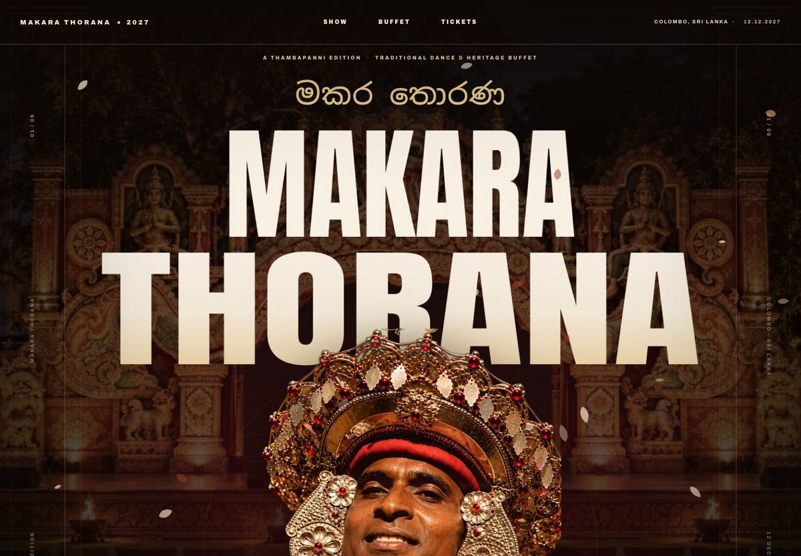

# MAKARA THORANA 2027 — a Thambapanni edition

A single-file website for **Makara Thorana 2027**, a Sri Lankan traditional
dance concert and heritage buffet. **Makara Thorana is the event**; Thambapanni
is the edition/masthead that presents it (and the supplied cover). One ticket,
one night: nine dance items, a 24-dish buffet, three seat tiers.

[](index.html)

**Open `index.html` in a browser.** Everything — fonts, photographs, SVG
ornament — is embedded, so the page works offline and can be sent as one file.

**Repo:** https://github.com/yuga666/Makara

---

## Deploy

The repository root is a static site. Enable **Settings → Pages → Deploy from a
branch → `main` / `root`**, and it will be live at
<https://yuga666.github.io/Makara/> (no build step, no dependencies).

---

## The design

The layout follows the supplied "Oda Nobunaga" UI pillar and translates it:

| Pillar | Here |
|---|---|
| Full-bleed hero, giant two-line title behind the subject | Night stage, `MAKARA / THORANA`, with the Ves dancer cut out of the supplied cover |
| Kanji line above the title | Sinhala **මකර තොරණ** (Noto Sans Sinhala, subset) |
| Scroll suit-up: armour builds, camera pushes in, petals fall | The gold halo, side pillars and stage line assemble, torches ignite, camera pushes into the dancer's face, jasmine/frangipani petals fall |
| Cream biodata: crest, six stats, bordered statement card with corner circles | "The arch and the earth": the event seal/masthead, six facts, the makara statement |
| — | Extended into the parts the brief needed: programme, buffet, tickets, visit, footer |

Palette: oxblood `#9e1526`, brass `#c9a227`, ink `#120a07`, cream `#f5ead9`.
Type: Anton (display), Archivo variable (UI), Cormorant Garamond italic
(accents), Noto Sans Sinhala (the local line). All four are self-hosted in the
file (SIL Open Font License).

### Interaction

- **Hero** — scroll drives `p` (first ~62% of a viewport). Camera scale +16%,
  title recedes, halo/pillars/stage line build in staggered windows, torch
  glows rise. The progress is eased and frame-smoothed.
- **Petals** — a canvas layer with ~14–42 hand-drawn petals, wind, spin and
  flutter. It only runs while the hero is in view.
- **Load** — title lines rise out of clipped masks (Web Animations API), then
  the strapline, nav, labels and dancer follow.
- **Programme** — sticky stage photograph; hovering a row floats the related
  image under the cursor.
- **Buffet** — a dense masonry grid with parallax inside each crop, a menu
  ledger with dietary marks, and a dish-name marquee.
- **Tickets** — three paper cards; booking opens a native `<dialog>` with a
  tier-aware request form and an inline confirmation.
- **Chrome** — fixed mini-bar after the hero, scroll-progress hairline, active
  section link, gold custom cursor (fine pointers only).
- **Reduced motion** — reveals are skipped, the hero starts fully assembled,
  petals and parallax stop, smooth scrolling is off.
- **Mobile** — the hero recomposes at ≤767px, the statement reflows without
  forced line breaks, and every u-based micro-label has a px override.

---

## Audit

| Check | Result |
|---|---|
| [Nu HTML Checker](https://validator.github.io/validator/) 26.11.14 | **0 errors** |
| axe-core 4.10.2 — WCAG 2.2 A/AA + best practice, 1440 px & 390 px | **0 violations** |
| Lighthouse 12.8.2 — Accessibility / Best Practices / SEO | **100 / 100 / 100** |
| Lighthouse 12.8.2 — desktop Performance | **89** (FCP/LCP 1.5 s, CLS 0, TBT 0 ms) |
| Lighthouse 12.8.2 — mobile Performance | **57** (FCP/LCP 8.5 s, CLS 0, TBT 0 ms) |
| Layout | no horizontal overflow at 320, 390, 768, 1024, 1280, 1440, 1920 px |
| Functional | booking dialog + tier prefill + confirmation, newsletter success, programme hover preview, all 15 images load |
| Assets | no unresolved placeholders, no external requests, no duplicate IDs, all anchors resolve, all images have `alt` |

The mobile performance number is the deliberate cost of the **single-file**
constraint: 2.1 MB of HTML (1.58 MB gzipped) has to download and parse before
first paint. Fonts, photographs and SVG are embedded by design. A split build
(external images, lazy loading, AVIF/WebP negotiation) would put this in the
90s; the single file is kept for portability. Everything else is green.

Reproduce:

```bash
python3 -m http.server 8765           # or any static server with gzip
npx lighthouse http://127.0.0.1:8765/index.html --preset=desktop
java -jar vnu.jar index.html
```

`scripts/audit.mjs` runs axe-core over CDP against a Chrome started with
`--remote-debugging-port=9222`; `scripts/shoot.mjs` takes screenshots and prints
layout diagnostics.

---

## Files

```
index.html            the deliverable — self-contained (2.1 MB)
build.py              inlines CSS, JS, fonts, images and SVG into index.html
src/page.html         markup
src/styles.css        styles
src/main.js           behaviour
assets/fonts/*.woff2  Anton, Archivo, Cormorant, Noto Sans Sinhala
assets/img/*.webp     prepared photographs (dancer is a transparent cut-out)
parts/*.svg           generated halo, pillars and stage line
scripts/prep_images.py   cover → dancer cut-out (black key + flood fill), crops
scripts/make_decor.py    halo / pillar / stage-line SVG generator
scripts/shoot.mjs        CDP screenshot + layout diagnostics helper
preview/*.jpg         reference screenshots
scripts/audit.mjs     axe-core accessibility audit over CDP
.gitignore            OS / dependency / QA noise
```

Rebuild after editing `src/`:

```bash
python3 build.py     # → index.html
```

`prep_images.py` and `make_decor.py` need Pillow; `build.py` is stdlib only.

## Notes on the content

- **Thambapanni / Tambapaṇṇī** is the island's earliest recorded name, the
  district where Prince Vijaya is said to have landed; the whole island later
  took the name.
- **Kandyan dance** grew out of the *Kohomba kankariya* ritual; the *Ves* is its
  most recognisable form, danced to the *Geta Bera* and *Thammattama*, with the
  *Thalampota* cymbals keeping time. The programme's nine items follow that
  tradition (Ves, Gajaga, Mayura, Udekki, Pantheru, Naiyandi, Vannam,
  Magul Bera).
- **The table** is the usual Sri Lankan spread: kiribath and lunu miris, rice
  and roti, ambul thiyal, polos, parippu, pol sambol, seeni sambol, kavum,
  kokis, aluwa, curd and kithul, thambili.
- **Makara Thorana** is the event: the guardian arch over a temple door.
  **Thambapanni** is the edition/masthead the event is published under — the
  island's earliest recorded name. The site keeps that hierarchy: event first,
  edition second.
- Event date, venue, prices and seat count are a concept edition (2027) and are
  marked as such in the footer. Swap them in `src/page.html` before going live.

Research references: [Kandyan dance](https://en.wikipedia.org/wiki/Kandyan_dance),
[Tambapaṇṇī](https://en.wikipedia.org/wiki/Tambapa%E1%B9%87%E1%B9%87%C4%AB).
